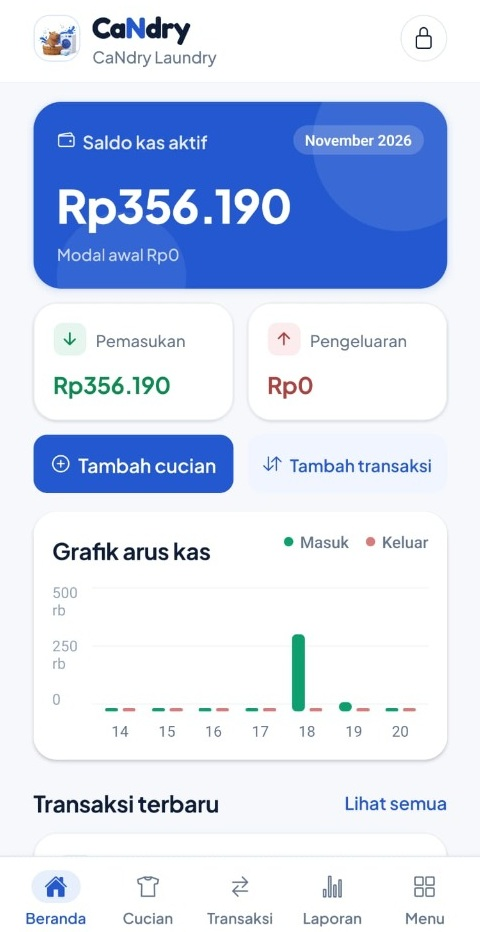
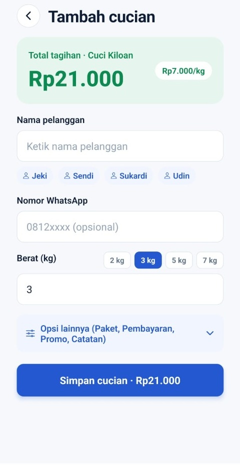
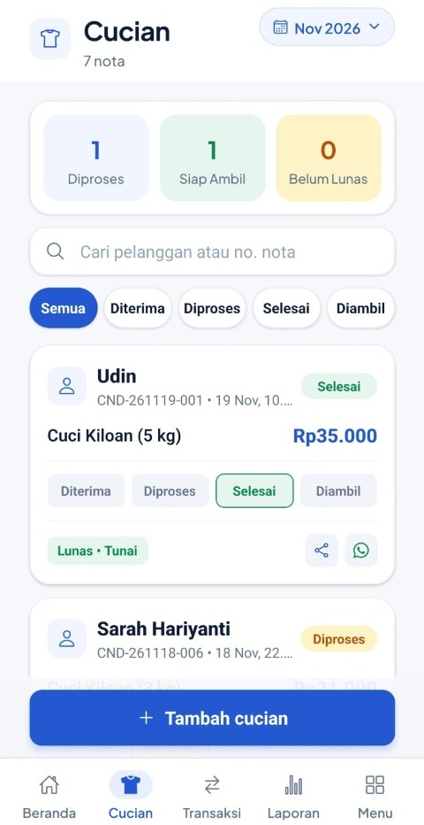
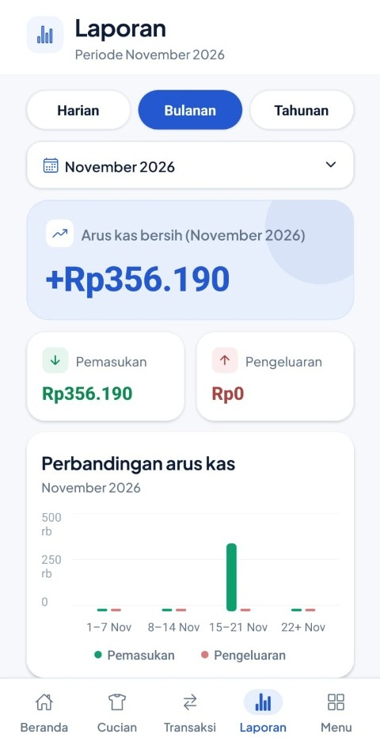
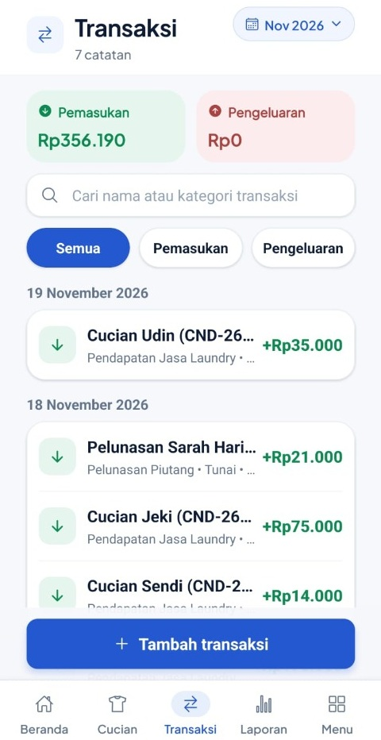
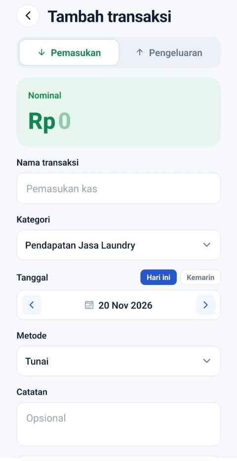
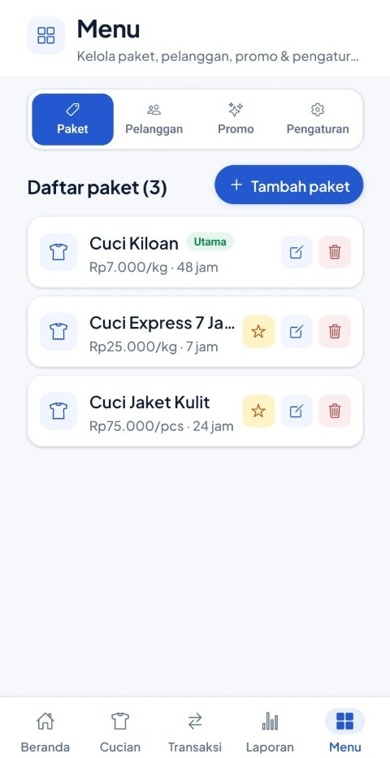
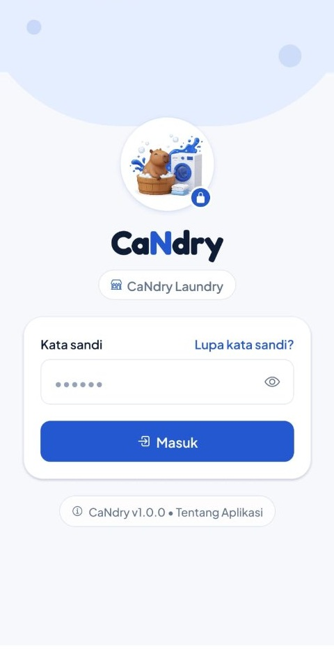

# CaNdry — Capybara Laundry POS

Aplikasi kasir (Point of Sale) dan pencatatan arus kas khusus usaha laundry yang bekerja **100% offline** di Android & iOS (React Native + Expo), dengan arsitektur siap integrasi cloud di masa depan.

- **Package ID:** `com.angsadev.capybaralaundry`
- **Kreator:** Angga Alfiansah (`anggaalfiansah26@gmail.com`)
- **Tim Pengembang:** Pengikut Raja Capybara
- **Publisher Play Store:** ANGSA Development Studio

---

## 📱 Tangkapan Layar (Screenshots)

| Beranda & Arus Kas | Catat Cucian Cepat | Daftar & Status Cucian | Laporan Arus Kas |
| :---: | :---: | :---: | :---: |
|  |  |  |  |

| Buku Kas Transaksi | Tambah Transaksi Kas | Paket, Pelanggan & Promo | Keamanan & Tentang |
| :---: | :---: | :---: | :---: |
|  |  |  |  |

> Materi lengkap untuk publikasi Google Play Store (Deskripsi Indonesia & Inggris, 8 slide promosi `1080×1920`, ikon `512×512`, *feature graphic* `1024×500`, serta panduan Data Safety) tersedia di [STORE_LISTING.md](./STORE_LISTING.md).

## Fitur Utama
- **Catat Cucian Cepat:** Ketik nama pelanggan (dengan saran otomatis) + berat (kg), atau buka opsi lanjutan untuk multi-paket, pembayaran DP/Bayar Nanti, promo, dan catatan.
- **Status Cucian 4 Tahap:** Diterima → Diproses → Selesai → Diambil dengan filter status & periode bulan.
- **Detail Nota & Bagikan:** Tampilan struk sesuai profil usaha laundry, bagikan foto struk (PNG), dan kirim rincian langsung ke WhatsApp.
- **Buku Kas Akuntansi:** Pencatatan pemasukan & pengeluaran dengan kategori akuntansi, lampiran foto bukti, serta pencatatan otomatis dari pembayaran cucian.
- **Laporan Harian / Bulanan / Tahunan:** Kartu arus kas bersih, grafik batang dinamis, rincian per kategori, dan export laporan PDF.
- **Keamanan & Backup Lokal:** Kunci kata sandi PBKDF2-SHA256 (sesi 1 jam), biometrik opsional, reset kode master statis, serta Export & Restore cadangan `.json`.

## Dokumen Play Store & Privasi
- [Materi Listing Google Play Store](./STORE_LISTING.md)
- [Kebijakan Privasi / Privacy Policy (Markdown)](./PRIVACY_POLICY.md)
- [Kebijakan Privasi (HTML / GitHub Pages)](./docs/privacy-policy.html)

## Cara Menjalankan Lokal
```bash
npm install
npx expo start
```

Untuk mengatur frasa kode master reset kata sandi sendiri sebelum build rilis:
```bash
npm run set-master-code
```

## Kustomisasi & Belajar
Ingin kustomisasi lebih lanjut atau belajar cara membuat aplikasi mobile seperti ini? Silakan **fork** repository ini atau hubungi kreator di `anggaalfiansah26@gmail.com`.
